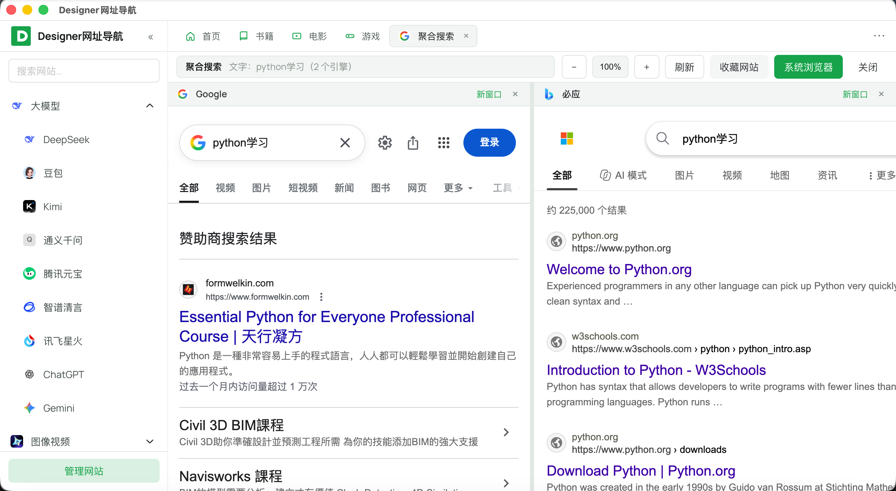
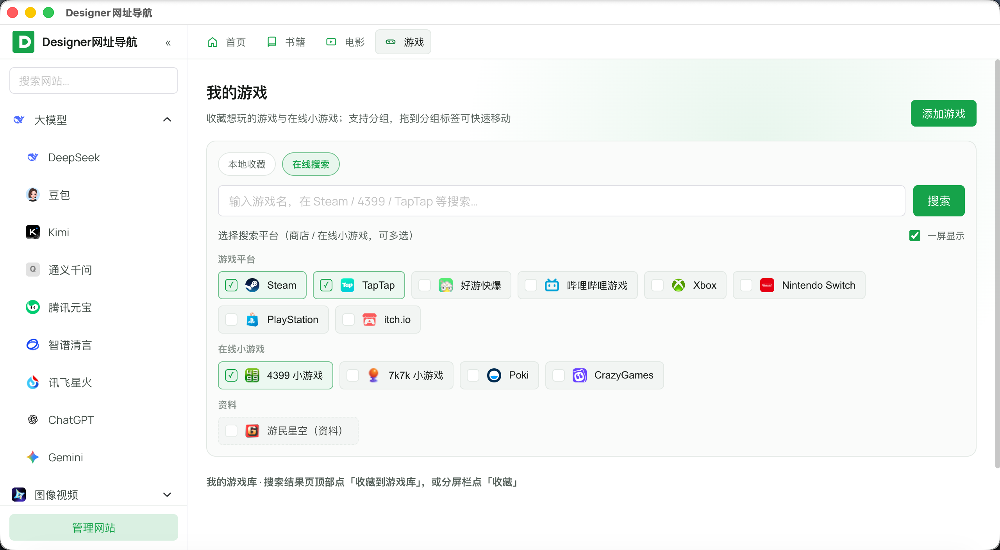
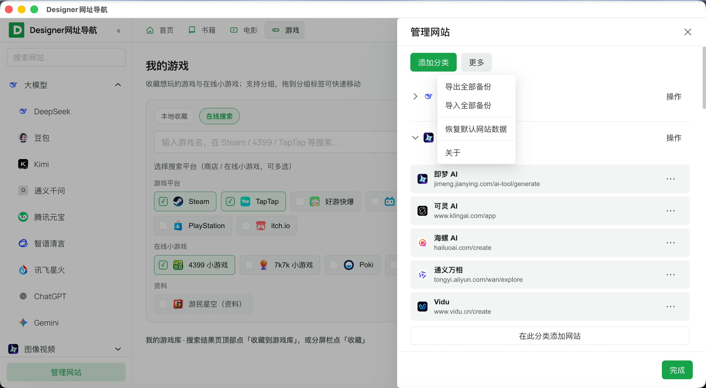

# Designer网址导航

Electron 桌面应用（包名 `designer-nav-web`）。右侧使用 **BrowserView** 加载真实网页（不是 iframe），不受 `X-Frame-Options` / CSP 嵌入限制。

```bash
npm install
npm run dev
```

## 打包

产物输出到 `release/`。

```bash
# macOS：生成 .dmg（x64 + arm64）
npm run dist:mac

# Windows：生成 NSIS 安装包 .exe（x64）
npm run dist:win

# 同时打 mac + win（需在 macOS 上；win 包会交叉编译）
npm run dist
```

说明：

- **macOS 包**：建议在 Mac 上打；未签名时首次打开需在「系统设置 → 隐私与安全性」里允许。
- **Windows 包**：在 Windows 上最稳；在 Mac 上也可 `npm run dist:win` 交叉编译，若失败请到 Windows 机器再打。
- 正式分发建议配置代码签名（Apple Developer / Windows 证书）。

## 功能

- 左侧分类导航：站点筛选、收起/展开
- 多标签：首页、书籍、电影、游戏固定；站点与搜索结果可并存、拖拽排序
- 聚合搜索：文字 / 图片 / 视频 / 开源；多引擎勾选、拖拽排序、一屏分屏
- Electron BrowserView 直达真实网页（非 iframe），支持缩放、刷新、系统浏览器打开
- 书籍 / 电影 / 游戏收藏架：分组管理、站内搜索、从浏览页一键收藏
- 编辑分类与站点；本地持久化；全部数据导入 / 导出备份；可恢复默认网站
  
## 效果预览

  







